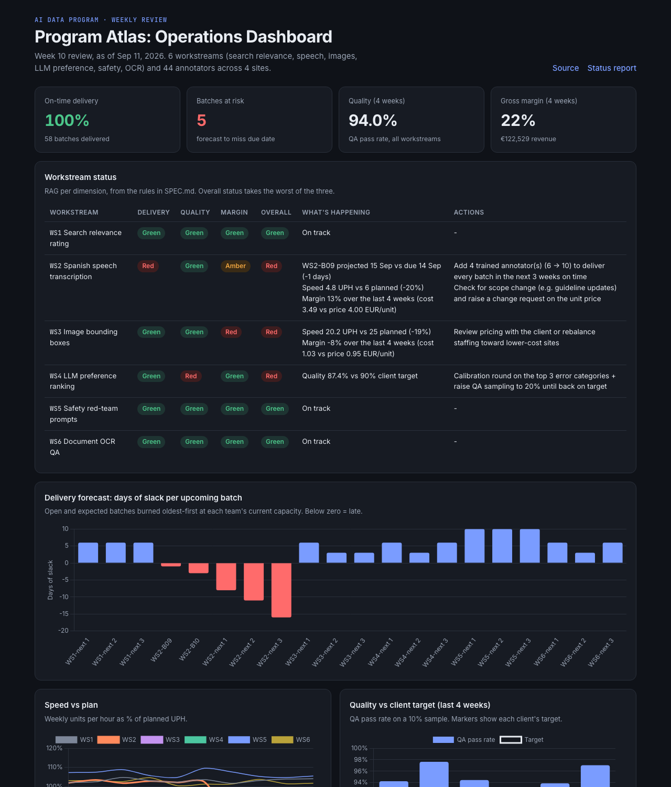
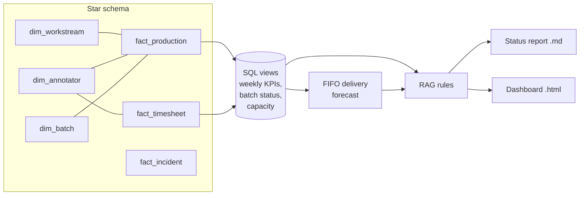

# AI Data Program Ops Dashboard

**The weekly program review for a multi-workstream AI training-data project: what's late, what's at risk, what's losing money, and what to do about it.**

A SQL data model and forecasting engine for an AI data program with 6 workstreams, 44 annotators across 4 sites, and weekly client batches with SLAs. It produces a RAG status per workstream, a delivery forecast that warns *before* a batch is late, and the weekly status report a program analyst sends to the client lead.

**[Live dashboard →](https://2077santi.github.io/ai-data-program-ops/)** · [Week 10 status report](reports/status_report_week_10.md) · [Spec & RAG rules](SPEC.md)



---

## The program (synthetic)

"Program Atlas" runs 6 workstreams for one AI client, each with its own unit, speed plan, quality target and price:

| Workstream | Unit | Planned speed | Quality target | Sites |
|---|---|---:|---:|---|
| WS1 Search relevance rating | judgment | 60 / h | 92% | Manila, Bogotá |
| WS2 Spanish speech transcription | audio minute | 6 / h | 95% | Barcelona, Bogotá |
| WS3 Image bounding boxes | image | 25 / h | 93% | Barcelona |
| WS4 LLM preference ranking | comparison | 18 / h | 90% | Lisbon, Barcelona |
| WS5 Safety red-team prompts | prompt | 8 / h | 90% | Barcelona, Lisbon |
| WS6 Document OCR QA | page | 40 / h | 96% | Manila |

The [generator](ops/generate_data.py) simulates 10 weeks of daily production, timesheets, a 10% QA sample, attrition and incidents, with three realistic problems hidden in the data.

## What the week 10 review found

| | Workstream | Problem | Recommended action |
|---|---|---|---|
| 🔴 | **WS2 Speech** | Guideline v2 (week 7) cut speed 20% and two annotators left in week 8. Every batch so far was on time, but the forecast shows **the next 5 batches will be 1-16 days late**. | Add 4 trained annotators (6 → 10); raise a change request, since v2 increased effort per unit |
| 🔴 | **WS3 Images** | Running at 81% of planned speed, so cost per image (€1.03) exceeds the price (€0.95): **-8% margin** | Review pricing or move volume to a lower-cost site |
| 🔴 | **WS4 LLM preference** | QA pass rate **87.4% vs 90%** client target | Calibration on top error categories; QA sampling to 20% until recovered |

The key point: **on-time delivery is 100% today**. A dashboard that only looks backward would show everything fine for another week. The forecast catches the miss before the client sees it.

## How it works



- **SQL model** ([`sql/views.sql`](sql/views.sql)): weekly KPI cube (units, UPH, quality, utilization, cost/unit, margin), batch status, and current capacity per workstream. Cost uses **paid hours from timesheets**, not production hours, so idle time shows up in margin the way it does in real P&Ls.
- **Delivery forecast:** open batches plus the next 3 contracted batches are burned oldest-first at each team's capacity over the last two weeks (speed × productive hours × attendance × headcount), on business days only.
- **Capacity planning:** for every workstream, the smallest headcount that delivers every batch on time. That turns "we're behind" into "we need 4 more people by Monday".
- **RAG rules** are explicit and testable ([SPEC.md](SPEC.md)): delivery by forecast slack, quality vs client target, margin vs a 15% floor.
- **Status report** with an owner per action (delivery lead, QA lead, account manager) and a "decisions needed from the client" section.

## Run it

```bash
python -m venv .venv && source .venv/bin/activate
pip install -r requirements.txt
make all     # generate data -> SQL model -> forecast -> report + dashboard
make test    # 10 tests
```

## Power BI

The star schema (`data/*.csv`) loads directly into Power BI: relate `fact_production[batch_id]` → `dim_batch`, `fact_production[annotator_id]` → `dim_annotator`, `dim_batch[workstream_id]` → `dim_workstream`. The measure definitions are in [`docs/power-bi-measures.md`](docs/power-bi-measures.md).

## Project structure

```
ops/generate_data.py   10-week program simulation (star schema CSVs)
sql/views.sql          DuckDB model: weekly KPIs, batch status, capacity
ops/pipeline.py        forecast, capacity planning, RAG status, actions
ops/report.py          weekly status report (Markdown)
tests/                 forecast unit tests + "finds the planted problems" end-to-end
SPEC.md                requirements, RAG rules, acceptance criteria
```

## Why I built this

As an operations analyst at TELUS Digital I owned SLAs, throughput and quality KPIs for AI data programs and ran the weekly KPI review between Project, Quality and Delivery. This is that review as code: the same questions, answered from the data every week instead of rebuilt by hand.

**Stack:** Python · DuckDB SQL · pandas · pytest · Chart.js · GitHub Actions

*All data is synthetic. No client or employer data is used.*
